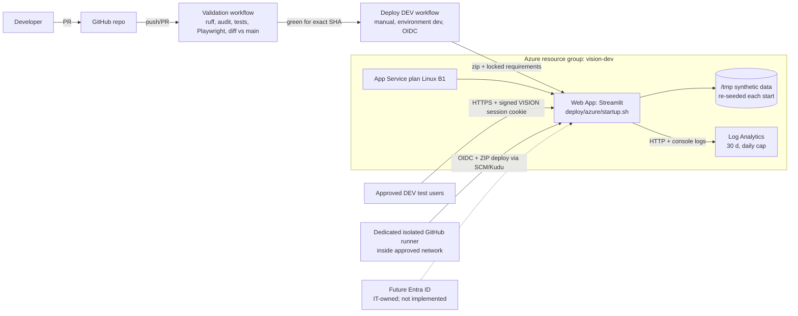

# VISION Azure DEV deployment (prepared, not executed)

**Status: code prepared only. No Azure resource exists, no credential is configured, nothing has been
deployed, and no cost has been incurred.** This uses one Linux App Service and a same-process ASGI
authentication layer; no container registry, database, or separate identity gateway is needed.

## Architecture

Deliberately **not** included: Container Registry, Key Vault, Application Insights, databases,
storage accounts, VNet/private endpoints, Front Door. None is needed for a synthetic-data demo.
Add them only through an IT-approved change.

## Files

| File | Purpose |
| --- | --- |
| `deploy/azure/main.bicep` | Plan, web app (system-assigned identity), Log Analytics, diagnostics. Compiled offline in CI (`az bicep build`); never applied by CI. |
| `deploy/azure/startup.sh` | Requires auth configuration, pins destructive reseeding to `/tmp/co-vision-dev-data`, and serves the `st.App` entrypoint with Uvicorn on `0.0.0.0:$PORT`. |
| `apps/vision/src/vision/auth.py` | Temporary signed-cookie identity provider, login/logout routes, and ASGI request gate. |
| `apps/vision/src/vision/authorization.py` | Separate user-to-role/scope registry and server-side row/stage filtering. |
| `apps/vision/src/vision/asgi_app.py` | Composes the Streamlit UI with the login routes and authentication middleware. |
| `scripts/hash_auth_password.py` | Interactive local PBKDF2 hash generation; prints only the hash. |
| `docs/temporary_authentication.md` | User registry, configuration, roles/scopes, limitations, and Entra migration boundary. |
| `.github/workflows/deploy-dev.yml` | Manual deploy and rollback workflow. Inert until enabled (see below). |
| `tests/auth/`, `tests/integration/test_asgi_auth.py` | Session, cookie, login/logout, role/scope, config, middleware, and ASGI composition tests. |
| `uv.lock` | Source of the locked runtime requirements exported into the package. |

Security defaults in the template: HTTPS only, TLS 1.2, FTPS disabled, SCM site restricted, **default
action Deny** for the site and SCM. SCM/Kudu explicitly reuses the main site's approved CIDR rules
(`scmIpSecurityRestrictionsUseMain: true`); the deployment runner must originate from one of those
allowed network ranges. The `allowedCidrs` parameter has no default, so the app is never public by
accident. WebSockets on (required by Streamlit), Always On, health check
`/_stcore/health`, no client affinity. Signing keys and test-user configuration are not in Bicep,
the workflow, or Git.

## Configuration and secrets

| Setting | Where | Value |
| --- | --- | --- |
| `SCM_DO_BUILD_DURING_DEPLOYMENT` | App setting (Bicep) | `true` (Oryx installs `requirements.txt`) |
| `WEBSITES_PORT` | App setting (Bicep) | `8000` |
| `CO_VISION_DATA_ROOT` | App setting (Bicep) | `/tmp/co-vision-dev-data` (ephemeral, synthetic) |
| `CO_VISION_PROOF_DB`, `CO_VISION_PROOF_REFERENCE_DB` | Never set in DEV | `startup.sh` unsets them |
| `VISION_AUTH_MODE` | App setting (Bicep) | `temporary` |
| `VISION_AUTH_PUBLIC_ORIGIN` | App setting (Bicep) | HTTPS default App Service hostname |
| `VISION_AUTH_COOKIE_SECRET` | Protected App Service setting / approved Key Vault reference | Random secret, at least 32 bytes; required |
| `VISION_TEMP_USERS_JSON` | Protected App Service setting / approved Key Vault reference | Preconfigured synthetic usernames and PBKDF2 password hashes |
| `VISION_AUTHZ_ASSIGNMENTS_JSON` | Protected App Service setting / approved Key Vault reference | Explicit role and data-scope assignments; required |
| `VISION_AUTH_SESSION_SECONDS` | Optional App Service setting | 300–86400 seconds; default 8 hours |
| `CO_VISION_TIMEZONE` | Only if the product owner approves one | - |

**The deployment workflow needs no GitHub secrets.** It uses OIDC and these
non-secret repository/environment **variables**: `AZURE_DEV_DEPLOY_ENABLED`, `AZURE_CLIENT_ID`,
`AZURE_TENANT_ID`, `AZURE_SUBSCRIPTION_ID`, `AZURE_DEV_WEBAPP_NAME`, `AZURE_DEV_RESOURCE_GROUP`, and
optionally `AZURE_DEV_SMOKE_URL`. If a secret ever becomes unavoidable, use Key Vault references
with the web app's managed identity, never GitHub secrets or the repository.

## Temporary authentication and access control

- The App Service endpoint is restricted by IP/VPN and also requires a VISION test account. The
  login route sets a VISION-signed cookie (`HttpOnly`, `SameSite=Strict`, `Secure` when HTTPS,
  eight-hour expiry by default); every request/WebSocket is checked server-side. Logout revokes the
  session in process memory and clears the cookie. Passwords are never stored: the registry accepts
  PBKDF2-SHA256 hashes with at least 600,000 iterations. Authentication fails closed if any required
  setting or assignment is missing.
- `VISION_TEMP_USERS_JSON` is a controlled allowlist; there is no public registration or role picker
  in authenticated mode. `VISION_AUTHZ_ASSIGNMENTS_JSON` is a separate authorization map. The
  supported assignments are Commercial (one exact commercial), Commercial Manager (one exact
  delegation), O2C (explicit stage list), and O2C Manager / Sales Director (also an explicit stage
  list, with no extra privileges until business permissions are approved). The Administrator
  profile is not assignable in authenticated DEV.
- The backend constrains Commercial and Manager source rows before rendering. O2C rows, stage
  controls, and visible stage labels are limited to the assigned stages; O2C PROOF history is
  withheld because no approved O2C history scope contract exists. If an assigned scope does not
  match current source options, access is denied. These are technical gates, not approval of
  business role semantics.
- Current user-to-data mapping and exact business permissions remain decisions for the product
  owner. In particular, a machine matching an authorized stage may have other business attributes;
  whether those can be shown to that role requires explicit approval. Do not configure production
  users or real customer/SAP data in this interim mode.
- This is **not corporate SSO**, does not reuse Microsoft cookies or tokens, and is not approved for
  production. Test passwords and hashes must be distributed through an IT-approved secure channel;
  no sample account is committed. A process restart invalidates sessions. The Streamlit UI rechecks
  the session every 30 seconds; changes to an already open screen may remain visible until that
  interval or the next interaction.
- A future Entra provider can implement the same request-identity interface using validated
  App-Service-authenticated claims; the authorization registry and role-scope enforcement remain
  separate. IT must own the Entra App Registration, required claims/groups, App Service
  Authentication set to require authentication, redirect/logout URLs and assignment policy. No
  Entra integration is implemented here. Microsoft cookies/passwords/tokens are never read or stored.
- The App Service managed identity has no resource role assignments and is not used for end-user
  authentication. No corporate or personal credentials are used by the app or CI.

## CI/CD flow and rollback

1. PR to `main` -> `Validation` (ruff, pip-audit, canonical check, tests + coverage, Bicep compile,
   Playwright, differential run against `main`). Branch protection should require it.
2. After merge, an authorized person runs **Deploy DEV (Azure App Service)** with `ref` = tag or SHA.
   The `gate` job refuses unless a successful `Validation` run exists for that exact commit.
3. The `deploy` job runs only on the dedicated self-hosted runner labelled
   `self-hosted, linux, x64, vision-dev-deploy`. IT must host it inside the approved corporate/VPN
   network, with outbound egress included in `allowedCidrs`. It uses GitHub Environment `dev`
   (configure required reviewers there), signs in with OIDC, builds the package from `uv.lock`,
   deploys through SCM/Kudu, and verifies the app reports `Running`. If `AZURE_DEV_SMOKE_URL` is set
   it also polls `/_stcore/health` from that same network. GitHub-hosted runners are deliberately
   not used for deployment because their IP ranges are broad/dynamic and GitHub advises against
   allowlisting them for internal resources; App Service's own health check (`healthCheckPath`)
   remains enabled.
4. **Rollback:** re-run the workflow with the previous known-good tag/SHA (it must also have a green
   Validation run). Tag each deployed commit (e.g. `dev-YYYYMMDD-n`). Deployment slots (swap) would
   need Standard (S1, ~$70/month) and are not worth it for DEV.
5. PROD is out of scope. Promotion must follow `docs/release_process.md` (same artifact validated in
   TEST, human approval).

## Health, readiness, persistence

- `/_stcore/health` is process liveness only; it says nothing about data. Do not add paths or counts
  to it. A data-readiness endpoint is not needed for the synthetic demo; add one only when real
  sources exist.
- Persistence: none by design. Data is re-seeded on every start under `/tmp`. SQLite must **not** be
  placed under `/home` (network-backed storage) or shared across instances; keep one instance. Durable
  data requires an approved managed-database adapter first.
- Restart/recovery: App Service restarts a failing instance from the health check; startup re-seeds in
  seconds. A cold start after a platform restart takes roughly a minute (dependency load).

## Monthly cost estimate (indicative, public retail, not a quote)

Conversion used: 1 USD is about 0.86 EUR. Prices vary by region/agreement; confirm in the
[Azure Pricing Calculator](https://azure.microsoft.com/pricing/calculator/) and with the KION Azure owner.

| Resource | Billing | Typical / month | Worst case with configured limits |
| --- | --- | ---: | ---: |
| App Service plan Linux **B1** (always on, 1 vCore, 1.75 GB) | Recurring (hourly) | ~$13 (~EUR 11) | same |
| Web app, managed identity, health check, HTTPS, IP restrictions, temporary cookie auth | Free (included in plan) | $0 | $0 |
| Log Analytics ingestion/retention | Consumption; first 5 GB/month per billing account is typically free; cap 0.2 GB/day | $0-3 | ~$16 (6 GB at ~$2.76/GB) |
| Storage | None used | $0 | $0 |
| Outbound traffic | First 100 GB/month free | ~$0 | small |
| GitHub Actions | Repo is private: uses the plan's included minutes (a run is about 6 min) | $0 within quota | plan-dependent |
| Entra app registration / OIDC federation / Bicep | Free | $0 | $0 |
| **Total** | | **~$13-16 (~EUR 11-14)** | **~$30 (~EUR 26)** |

Well inside the EUR 200/month ceiling, which is a limit, not a commitment. Not included:
**Azure Developer support (about $29/month) is a separate subscription-level charge**, not part of this
infrastructure estimate; tax, support plans and any enterprise discount are also excluded. Resources
with recurring charges: the App Service plan (even if the app is stopped) and Log Analytics. Delete the
resource group to stop all charges. Set an Azure Budget alert (for example EUR 50) before provisioning.

## What IT must provide or decide

1. Subscription, region, resource group `vision-dev`, naming, tags, cost center, and a budget alert.
2. Permission to create the resources above (Contributor on the resource group is sufficient; no
   subscription-level rights needed).
3. An identity for GitHub: a user-assigned identity or app registration with a **federated credential**
   for `repo:MarianoStill/VISION:environment:dev`, with Contributor (or Website Contributor plus Reader)
   scoped to the resource group only. No client secret.
4. The allowed CIDR ranges (corporate egress/VPN) for `allowedCidrs`, and whether GitHub runners may reach
   the app for the smoke test.
5. Approved synthetic DEV user list and role/scope mapping; secure distribution of test passwords.
6. Temporary cookie-signing secret and protected App Service settings (or an approved Key Vault
   reference). No credentials or hashes in GitHub variables or source files.
7. Entra app registration and policy for future App Service Authentication, allowed users/groups,
   claim contract, redirect URI and logout policy.
8. Confirmation that a private-repo GitHub-to-Azure OIDC integration and a Python 3.13 App Service
   runtime are acceptable/available (`az webapp list-runtimes --os linux`).
9. Log retention/privacy requirement and who owns monitoring and alerts.
10. Confirmation that DEV contains synthetic data only; any real data requires a separate approval.

## First deployment steps (after the gates above; none executed)

1. IT creates the resource group and the federated identity; the owner sets a budget alert.
2. Provision: `az deployment group create -g vision-dev -f deploy/azure/main.bicep -p webAppName=<unique> allowedCidrs='["<cidr>"]'`
   (use `--what-if` first). Review the output.
3. Configure the protected App Service settings for the cookie secret, synthetic hashed users,
   explicit role scopes, and any approved origin override. Do not put secret values in Bicep.
4. In GitHub: create Environment `dev` with required reviewers; add the variables listed above; finally set
   `AZURE_DEV_DEPLOY_ENABLED=true`.
5. Register the dedicated runner with the labels above, confirm its outbound IP is in `allowedCidrs`,
   then run **Deploy DEV** with the validated `main` SHA; approve the environment gate.
6. From an allowed network, use the authorized synthetic test account, check `/_stcore/health`, and
   confirm each account can see only its assigned synthetic scope. Tag the commit; record it as rollback target.
7. When IT approves, integrate Entra through the identity-provider interface and separately validate
   group-to-role/scope assignments. Do not enable Entra by reusing browser cookies or tokens.

## Risks and limitations

- Temporary DEV identity is self-managed and not backed by a corporate directory. No real
  authentication or production authorization is implemented.
- Scope semantics are technically enforced for current Commercial, Manager, and O2C data paths, but
  business owners have not approved the role meanings or cross-stage machine visibility.
- Deployment requires IT to provide and maintain the dedicated self-hosted runner in the approved
  network. If it is offline or its egress CIDR changes, deployment/smoke tests will fail closed.
- Not validated against a real Azure subscription: the Bicep file is syntax-checked in CI only, the
  Python 3.13 runtime and Oryx build of the exported `requirements.txt` are untested on App Service, and
  the cost figures are public estimates. Expect adjustments on the first dry run (`--what-if`).
- B1 is a single shared-tenant instance: no autoscale, no SLA-grade redundancy, no slots; downtime during
  restarts/deploys is expected.
- Ephemeral data: every restart resets state, including notes/comments entered in the demo.
- Dependency scanning is point-in-time (`pip-audit` in CI); Dependabot alerts are disabled in the repo.
- Streamlit's XSRF/CORS protections are left enabled; do not disable them to work around proxy issues.
- Differences from PROD (future): real identity and RBAC, real data sources behind approval, managed
  database with backups, private networking, TEST-to-PROD promotion of the same artifact, slots/redundancy,
  and an incident/monitoring process. None of that exists yet.

References: [App Service Python](https://learn.microsoft.com/azure/app-service/configure-language-python),
[health check](https://learn.microsoft.com/azure/app-service/monitor-instances-health-check),
[access restrictions](https://learn.microsoft.com/azure/app-service/app-service-ip-restrictions),
[App Service authentication](https://learn.microsoft.com/azure/app-service/overview-authentication-authorization),
[GitHub OIDC with Azure](https://learn.microsoft.com/azure/developer/github/connect-from-azure-openid-connect),
[App Service pricing](https://azure.microsoft.com/pricing/details/app-service/linux/),
[Azure Monitor pricing](https://azure.microsoft.com/pricing/details/monitor/).
