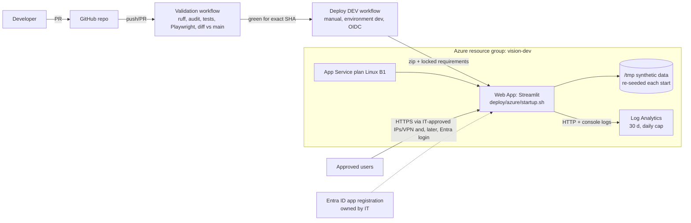

# VISION Azure DEV deployment (prepared, not executed)

**Status: preparation only. No Azure resource exists, no credential is configured, nothing has been
deployed, and no cost has been incurred.** This replaces the earlier Container Apps proposal: for one
Streamlit app with synthetic data, Azure App Service is simpler and cheaper (no registry, no image
build, built-in health check, HTTPS, access restrictions and optional built-in authentication).

## Architecture

Deliberately **not** included: Container Registry, Key Vault, Application Insights, databases,
storage accounts, VNet/private endpoints, Front Door. None is needed for a synthetic-data demo.
Add them only through an IT-approved change.

## Files

| File | Purpose |
| --- | --- |
| `deploy/azure/main.bicep` | Plan, web app (system-assigned identity), Log Analytics, diagnostics. Compiled offline in CI (`az bicep build`); never applied by CI. |
| `deploy/azure/startup.sh` | App Service startup command: sets `PYTHONPATH`, seeds **synthetic** data into `/tmp`, starts Streamlit on `0.0.0.0:$PORT`. |
| `.github/workflows/deploy-dev.yml` | Manual deploy and rollback workflow. Inert until enabled (see below). |
| `tests/integration/test_deploy_config.py` | Guardrails: manual-only, secretless, fail-closed, deny-by-default, hardened settings. |
| `uv.lock` | Source of the locked runtime requirements exported into the package. |

Security defaults in the template: HTTPS only, TLS 1.2, FTPS disabled, SCM site restricted, **default
action Deny** for the site and SCM (the `allowedCidrs` parameter has no default, so the app is never
public by accident), WebSockets on (required by Streamlit), Always On, health check
`/_stcore/health`, no client affinity, no secrets in app settings.

## Configuration and secrets

| Setting | Where | Value |
| --- | --- | --- |
| `SCM_DO_BUILD_DURING_DEPLOYMENT` | App setting (Bicep) | `true` (Oryx installs `requirements.txt`) |
| `WEBSITES_PORT` | App setting (Bicep) | `8000` |
| `CO_VISION_DATA_ROOT` | App setting (Bicep) | `/tmp/co-vision-dev-data` (ephemeral, synthetic) |
| `CO_VISION_PROOF_DB`, `CO_VISION_PROOF_REFERENCE_DB` | Never set in DEV | `startup.sh` unsets them |
| `CO_VISION_TIMEZONE` | Only if the product owner approves one | - |

**Application secrets required today: none.** GitHub secrets: none. The workflow uses OIDC and these
non-secret repository/environment **variables**: `AZURE_DEV_DEPLOY_ENABLED`, `AZURE_CLIENT_ID`,
`AZURE_TENANT_ID`, `AZURE_SUBSCRIPTION_ID`, `AZURE_DEV_WEBAPP_NAME`, `AZURE_DEV_RESOURCE_GROUP`, and
optionally `AZURE_DEV_SMOKE_URL`. If a secret ever becomes unavoidable, use Key Vault references
with the web app's managed identity, never GitHub secrets or the repository.

## Authentication and access control (decision for IT)

- The in-app role picker (Commercial/Manager/O2C/Administrator) is **navigation, not authorization**.
  Anyone who reaches the URL can choose Administrator. Therefore: synthetic data only, and the
  network gate (allowed IPs/VPN) is mandatory until real authentication exists.
- Recommended path once IT authorizes it: App Service Authentication (Entra) with "require
  authentication", user/group assignment on the enterprise application, then server-side mapping of
  groups to roles in a reviewed code change. Neither SSO nor Entra is implemented or configured here.
- No corporate/personal credentials are used by the app or by CI. The managed identity has no role
  assignments and needs none.

## CI/CD flow and rollback

1. PR to `main` -> `Validation` (ruff, pip-audit, canonical check, tests + coverage, Bicep compile,
   Playwright, differential run against `main`). Branch protection should require it.
2. After merge, an authorized person runs **Deploy DEV (Azure App Service)** with `ref` = tag or SHA.
   The `gate` job refuses unless a successful `Validation` run exists for that exact commit.
3. The `deploy` job uses GitHub Environment `dev` (configure required reviewers there), signs in with
   OIDC, builds the package from `uv.lock`, deploys it, and verifies the app reports `Running`. If
   `AZURE_DEV_SMOKE_URL` is set it also polls `/_stcore/health`. GitHub-hosted runners are blocked by
   the IP restrictions unless IT allows them, so the smoke test is optional; App Service's own health
   check (`healthCheckPath`) is always on.
4. **Rollback:** re-run the workflow with the previous known-good tag/SHA (it must also have a green
   Validation run). Tag each deployed commit (e.g. `dev-YYYYMMDD-n`). Deployment slots (swap) would
   need Standard (S1, ~$70/month) and are not worth it for DEV.
5. PROD is out of scope. Promotion must follow `docs/release_process.md` (same artifact validated in
   TEST, human approval).

## Health, readiness, persistence

- `/_stcore/health` is process liveness only; it says nothing about data. Do not add paths or counts
  to it. A data-readiness endpoint is not needed for the synthetic demo; add one only when real
  sources exist.
- Persistence: none by design. Data is re-seeded on every start under `/tmp`. SQLite must **not** be
  placed under `/home` (network-backed storage) or shared across instances; keep one instance. Durable
  data requires an approved managed-database adapter first.
- Restart/recovery: App Service restarts a failing instance from the health check; startup re-seeds in
  seconds. A cold start after a platform restart takes roughly a minute (dependency load).

## Monthly cost estimate (indicative, public retail, not a quote)

Conversion used: 1 USD is about 0.86 EUR. Prices vary by region/agreement; confirm in the
[Azure Pricing Calculator](https://azure.microsoft.com/pricing/calculator/) and with the KION Azure owner.

| Resource | Billing | Typical / month | Worst case with configured limits |
| --- | --- | ---: | ---: |
| App Service plan Linux **B1** (always on, 1 vCore, 1.75 GB) | Recurring (hourly) | ~$13 (~EUR 11) | same |
| Web app, managed identity, health check, HTTPS, IP restrictions, built-in Entra auth | Free (included in plan) | $0 | $0 |
| Log Analytics ingestion/retention | Consumption; first 5 GB/month per billing account is typically free; cap 0.2 GB/day | $0-3 | ~$16 (6 GB at ~$2.76/GB) |
| Storage | None used | $0 | $0 |
| Outbound traffic | First 100 GB/month free | ~$0 | small |
| GitHub Actions | Repo is private: uses the plan's included minutes (a run is about 6 min) | $0 within quota | plan-dependent |
| Entra app registration / OIDC federation / Bicep | Free | $0 | $0 |
| **Total** | | **~$13-16 (~EUR 11-14)** | **~$30 (~EUR 26)** |

Well inside the EUR 200/month ceiling, which is a limit, not a commitment. Not included:
**Azure Developer support (about $29/month) is a separate subscription-level charge**, not part of this
infrastructure estimate; tax, support plans and any enterprise discount are also excluded. Resources
with recurring charges: the App Service plan (even if the app is stopped) and Log Analytics. Delete the
resource group to stop all charges. Set an Azure Budget alert (for example EUR 50) before provisioning.

## What IT must provide or decide

1. Subscription, region, resource group `vision-dev`, naming, tags, cost center, and a budget alert.
2. Permission to create the resources above (Contributor on the resource group is sufficient; no
   subscription-level rights needed).
3. An identity for GitHub: a user-assigned identity or app registration with a **federated credential**
   for `repo:MarianoStill/VISION:environment:dev`, with Contributor (or Website Contributor plus Reader)
   scoped to the resource group only. No client secret.
4. The allowed CIDR ranges (corporate egress/VPN) for `allowedCidrs`, and whether GitHub runners may reach
   the app for the smoke test.
5. Entra app registration and policy for App Service Authentication, allowed users/groups, claim contract.
6. Confirmation that a private-repo GitHub-to-Azure OIDC integration and a Python 3.13 App Service
   runtime are acceptable/available (`az webapp list-runtimes --os linux`).
7. Log retention/privacy requirement and who owns monitoring and alerts.
8. Confirmation that DEV contains synthetic data only; any real data requires a separate approval.

## First deployment steps (after the gates above; none executed)

1. IT creates the resource group and the federated identity; the owner sets a budget alert.
2. Provision: `az deployment group create -g vision-dev -f deploy/azure/main.bicep -p webAppName=<unique> allowedCidrs='["<cidr>"]'`
   (use `--what-if` first). Review the output.
3. In GitHub: create Environment `dev` with required reviewers; add the variables listed above; finally set
   `AZURE_DEV_DEPLOY_ENABLED=true`.
4. Run **Deploy DEV** with the validated `main` SHA; approve the environment gate.
5. From an allowed network, open the app, check `/_stcore/health`, and exercise each profile with
   synthetic data. Tag the commit; record it as the rollback target.
6. When IT approves, configure App Service Authentication and remove any reliance on the IP gate alone.

## Risks and limitations

- No real authentication or server-side authorization yet; the IP/VPN gate is the only barrier. The
  Administrator screen can be selected by any reachable user (synthetic data only, destructive actions
  affect only disposable `/tmp` data).
- Not validated against a real Azure subscription: the Bicep file is syntax-checked in CI only, the
  Python 3.13 runtime and Oryx build of the exported `requirements.txt` are untested on App Service, and
  the cost figures are public estimates. Expect adjustments on the first dry run (`--what-if`).
- B1 is a single shared-tenant instance: no autoscale, no SLA-grade redundancy, no slots; downtime during
  restarts/deploys is expected.
- Ephemeral data: every restart resets state, including notes/comments entered in the demo.
- Dependency scanning is point-in-time (`pip-audit` in CI); Dependabot alerts are disabled in the repo.
- Streamlit's XSRF/CORS protections are left enabled; do not disable them to work around proxy issues.
- Differences from PROD (future): real identity and RBAC, real data sources behind approval, managed
  database with backups, private networking, TEST-to-PROD promotion of the same artifact, slots/redundancy,
  and an incident/monitoring process. None of that exists yet.

References: [App Service Python](https://learn.microsoft.com/azure/app-service/configure-language-python),
[health check](https://learn.microsoft.com/azure/app-service/monitor-instances-health-check),
[access restrictions](https://learn.microsoft.com/azure/app-service/app-service-ip-restrictions),
[App Service authentication](https://learn.microsoft.com/azure/app-service/overview-authentication-authorization),
[GitHub OIDC with Azure](https://learn.microsoft.com/azure/developer/github/connect-from-azure-openid-connect),
[App Service pricing](https://azure.microsoft.com/pricing/details/app-service/linux/),
[Azure Monitor pricing](https://azure.microsoft.com/pricing/details/monitor/).
